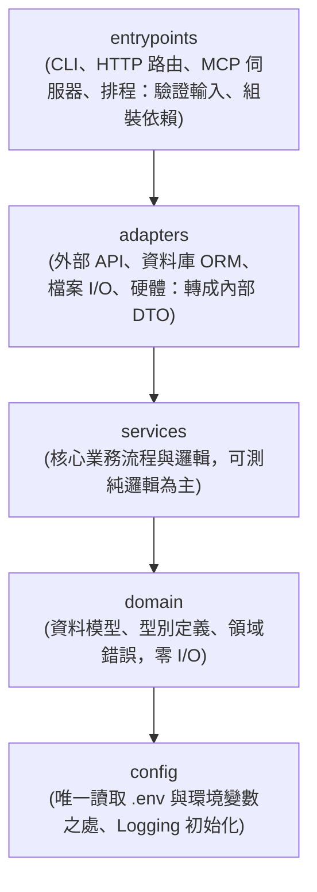

# 系統分層架構與工程守則 (Architecture Layers & Guardrails)

> **任務載入時機**：新增模組、調整 import、規劃系統邊界或設定專案分層時必讀。

---

## 1. 可配置的單向依賴分層

專案預設由五個單向層級組成（定義於 `.agents/project.toml` 中的 `[architecture] layers`）：

- **單向原則**：上層可引用下層，下層**嚴禁逆向引用**上層（`agentctl check` 會自動掃描攔截）。
- **依賴注入**：`entrypoints` 負責組裝 adapters 並傳給 services，讓 services 不直接綁定外部網路或檔案系統，保證測試可替換。

---

## 2. 大型系統 10 大核心工程守則

1. **單向依賴 (Unidirectional Dependency)**：嚴格遵守分層方向，禁止循環引用。
2. **環境零污染 (Zero Global Pollution)**：套件只裝在專案內（uv/pnpm），密鑰放 `.env`，憑證檔放 `~/.config/<專案>/`（權限 600）。
3. **外部 API 防腐層 (Anti-Corruption Layer)**：第三方回應在 `adapters` 層轉換為純 DTO，捕捉底層例外並映射為標準 Domain 錯誤。
4. **核心與 I/O 解耦 (I/O Decoupling)**：`services` 只透過參數接收 adapter，不自行發起連線或直接讀取環境變數。
5. **冪等性與防重送 (Idempotency)**：對外部 Webhook 與佇列消費實作防重機制，防止副作用重複執行。
6. **短生命週期鎖 (Short-Lived Locks)**：資料庫鎖或並發鎖只包覆記憶體操作，**嚴禁在持有鎖期間發起慢速網路呼叫**。
7. **外部依賴降級與補償 (Fallback & Compensation)**：外部呼叫失敗時執行對應的補償回滾操作，並回覆友善錯誤。
8. **儲存防衛與向後相容 (Storage Hygiene)**：新增欄位保持向下相容，資料庫結構變更必須提供 Alembic 遷移檔。
9. **目錄樹與入口防脫節 (Drift Detection)**：架構變更後透過 `agentctl sync` 與 `agentctl tree` 自動同步文件與入口。
10. **四向溯源體系 (Four-Way Traceability)**：重大決策記 ADR，踩坑除錯記 ISSUE，在程式碼、測試與 commit 訊息相互參照。
